# lmnum

**Numerical computing for lmscript in one static executable: Eigen, SUNDIALS, integration, root finding, optimization and fitting.**

[](https://github.com/lmctl-ai/lmnum/actions/workflows/ci.yml)
[](https://github.com/lmctl-ai/lmnum/releases)
[](LICENSE)

### Differential equations

| 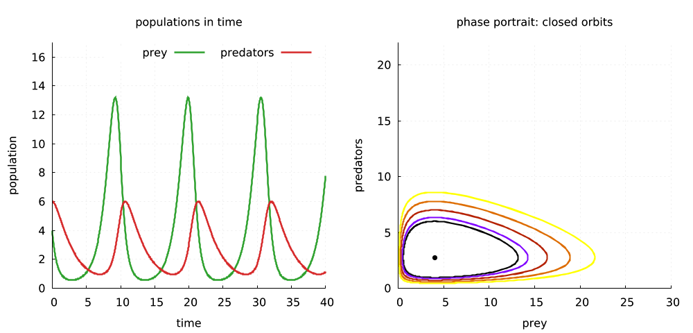 | 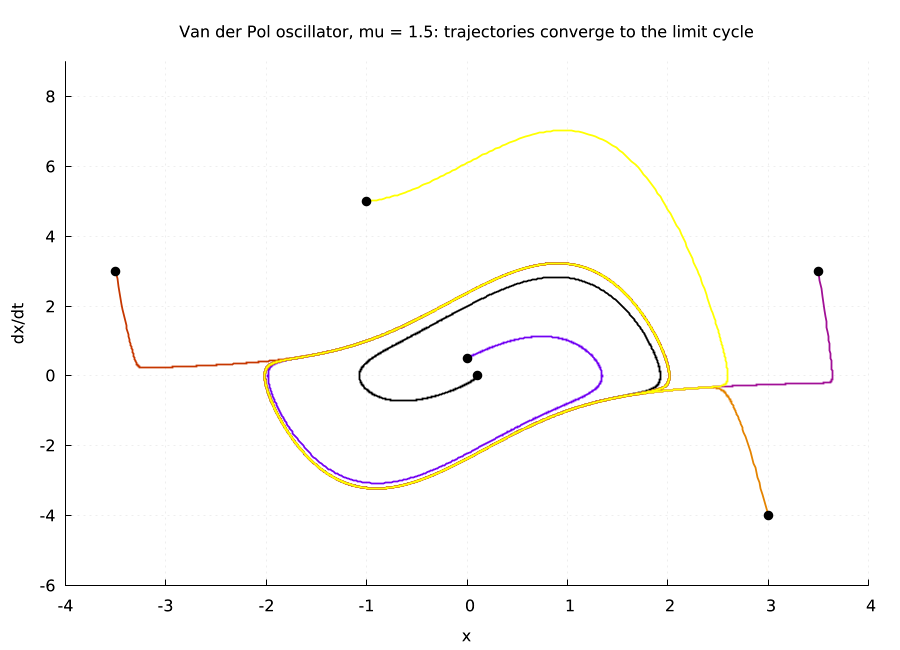 |
| --- | --- |
| Lotka-Volterra: populations in time and closed orbits in phase space.<br>`lmctl autorun https://raw.githubusercontent.com/lmctl-ai/lmnum/main/examples/gallery/predator_prey.lms` | Van der Pol oscillator: every start converges to the limit cycle.<br>`lmctl autorun https://raw.githubusercontent.com/lmctl-ai/lmnum/main/examples/gallery/van_der_pol.lms` |

| 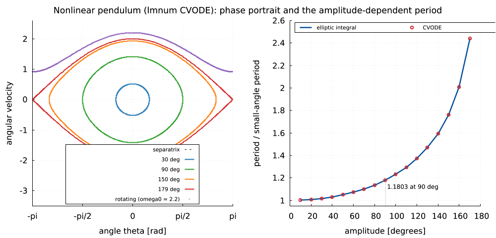 | 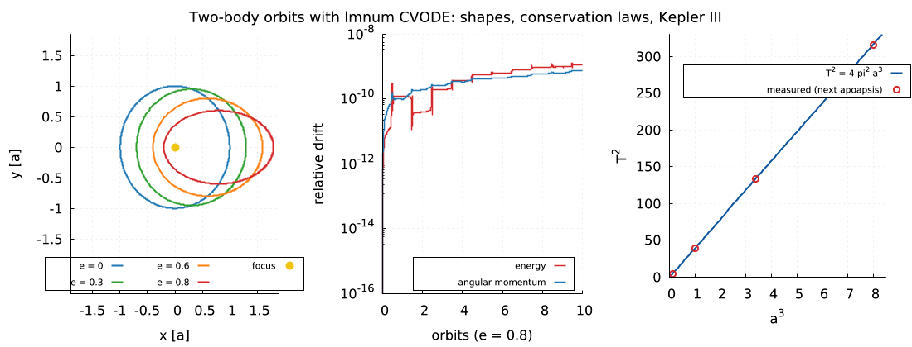 |
| --- | --- |
| Nonlinear pendulum: phase portrait with the separatrix, and the period against amplitude on the elliptic-integral curve.<br>`lmctl autorun https://raw.githubusercontent.com/lmctl-ai/lmnum/main/examples/gallery/pendulum.lms` | Two-body orbits: shapes, energy and angular momentum conserved to 1e-9, Kepler's third law measured.<br>`lmctl autorun https://raw.githubusercontent.com/lmctl-ai/lmnum/main/examples/gallery/orbital.lms` |

| 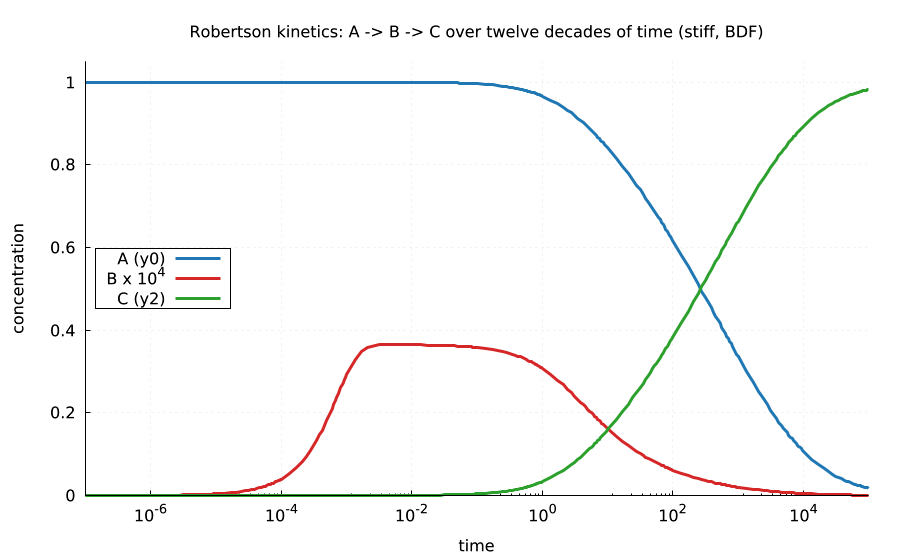 | 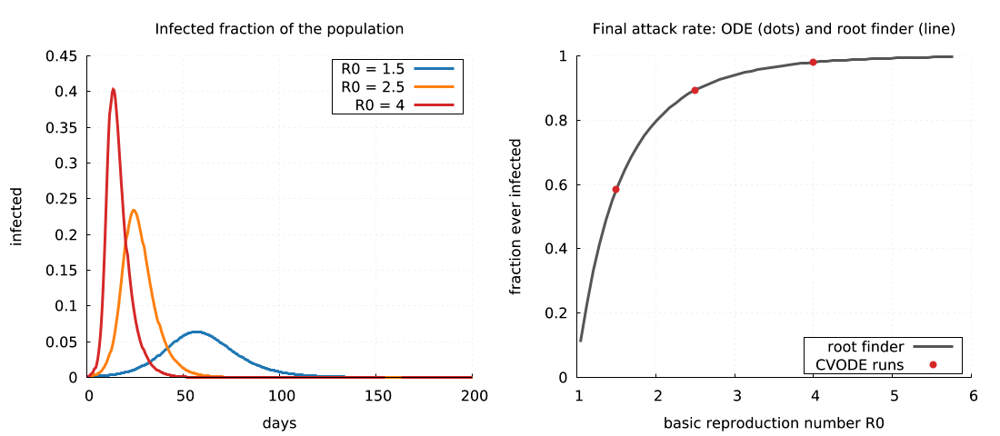 |
| --- | --- |
| Robertson kinetics over twelve decades of time (stiff, BDF).<br>`lmctl autorun https://raw.githubusercontent.com/lmctl-ai/lmnum/main/examples/gallery/stiff_kinetics.lms` | An epidemic and the equation that predicts its size: CVODE against a root finder.<br>`lmctl autorun https://raw.githubusercontent.com/lmctl-ai/lmnum/main/examples/gallery/sir_epidemic.lms` |

| 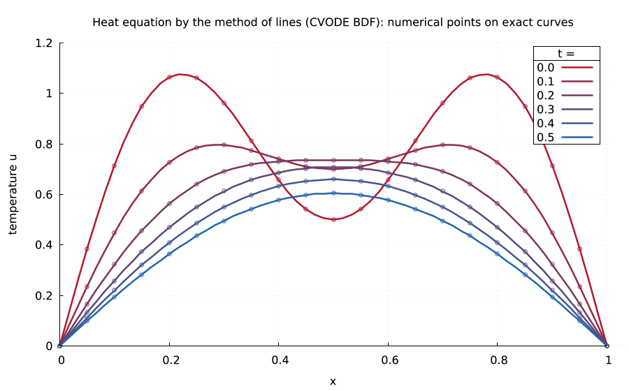 | 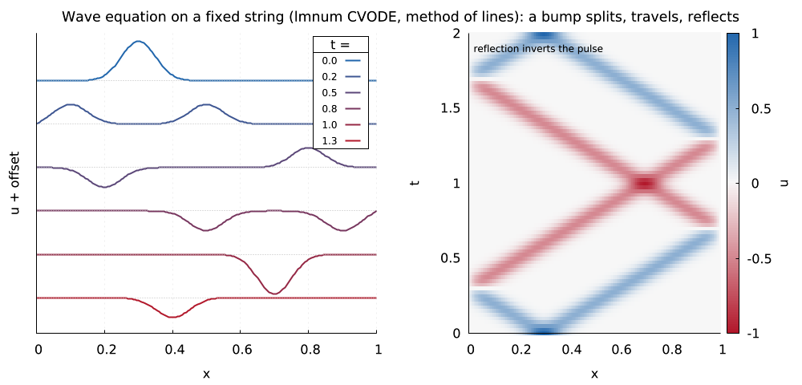 |
| --- | --- |
| The heat equation as a stiff ODE system, numerical points on the exact curves.<br>`lmctl autorun https://raw.githubusercontent.com/lmctl-ai/lmnum/main/examples/gallery/heat_diffusion.lms` | The wave equation by the method of lines: a bump splits, travels at speed c, reflects inverted (d'Alembert checked).<br>`lmctl autorun https://raw.githubusercontent.com/lmctl-ai/lmnum/main/examples/gallery/wave_equation.lms` |

| 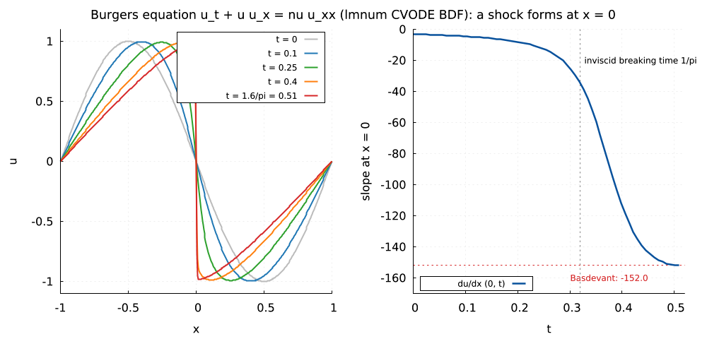 | |
| --- | --- |
| Burgers' equation: the shock forms at x = 0 and its slope reaches the Basdevant benchmark -152.<br>`lmctl autorun https://raw.githubusercontent.com/lmctl-ai/lmnum/main/examples/gallery/burgers.lms` | |

### Chaos and nonlinear maps

|  | 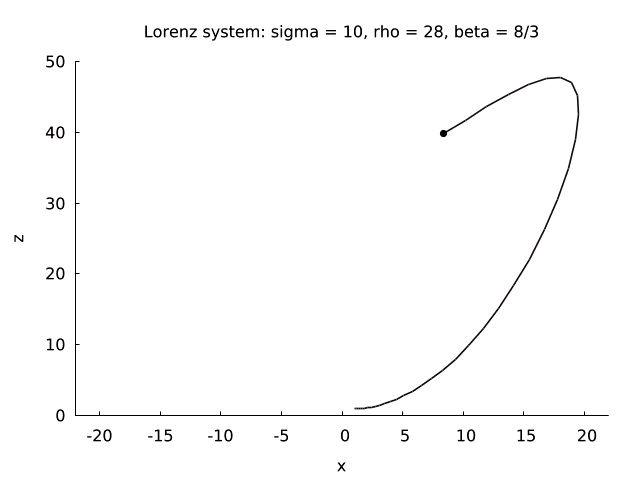 |
| --- | --- |
| The Lorenz attractor, coloured by time.<br>`lmctl autorun https://raw.githubusercontent.com/lmctl-ai/lmnum/main/examples/gallery/lorenz_attractor.lms` | The Lorenz butterfly, animated (needs ffmpeg).<br>`lmctl autorun https://raw.githubusercontent.com/lmctl-ai/lmnum/main/examples/gallery/lorenz_anim.lms` |

| 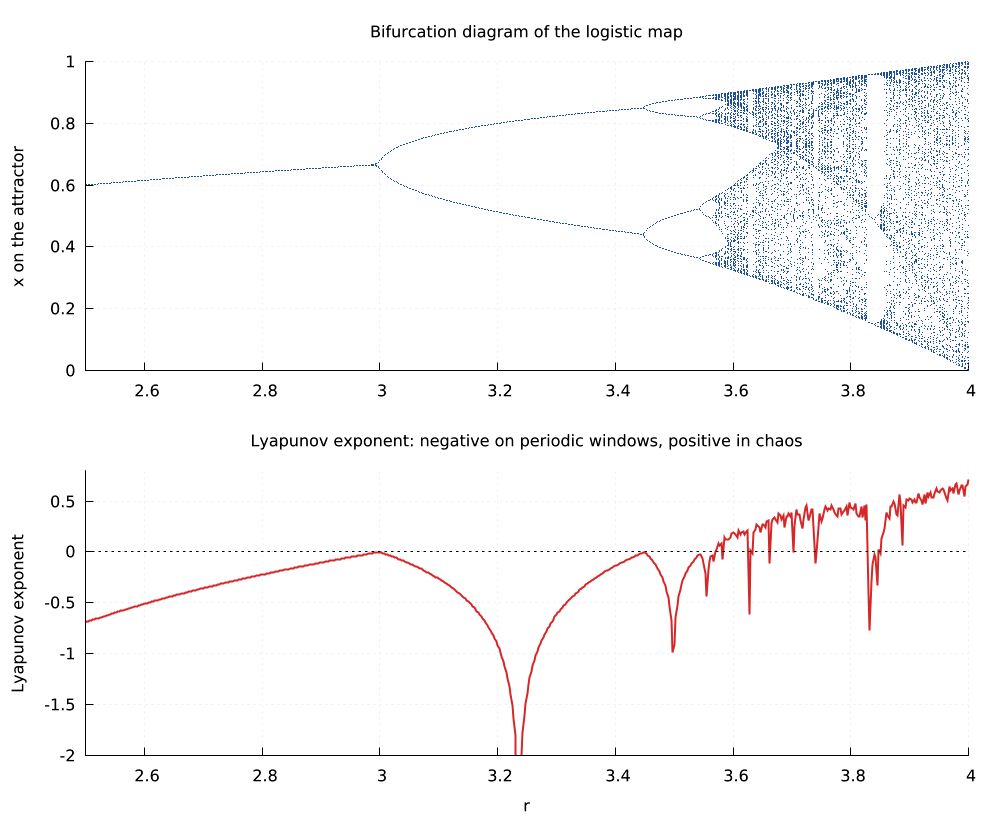 | 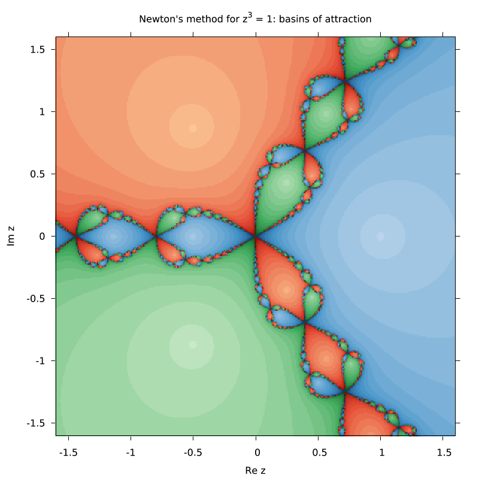 |
| --- | --- |
| Route to chaos: bifurcation diagram and Lyapunov exponent of the logistic map.<br>`lmctl autorun https://raw.githubusercontent.com/lmctl-ai/lmnum/main/examples/gallery/logistic_bifurcation.lms` | Newton's method for z^3 = 1: basins of attraction.<br>`lmctl autorun https://raw.githubusercontent.com/lmctl-ai/lmnum/main/examples/gallery/newton_fractal.lms` |

### Linear algebra, fitting and statistics

| 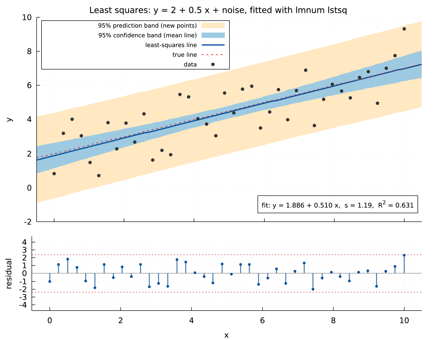 | 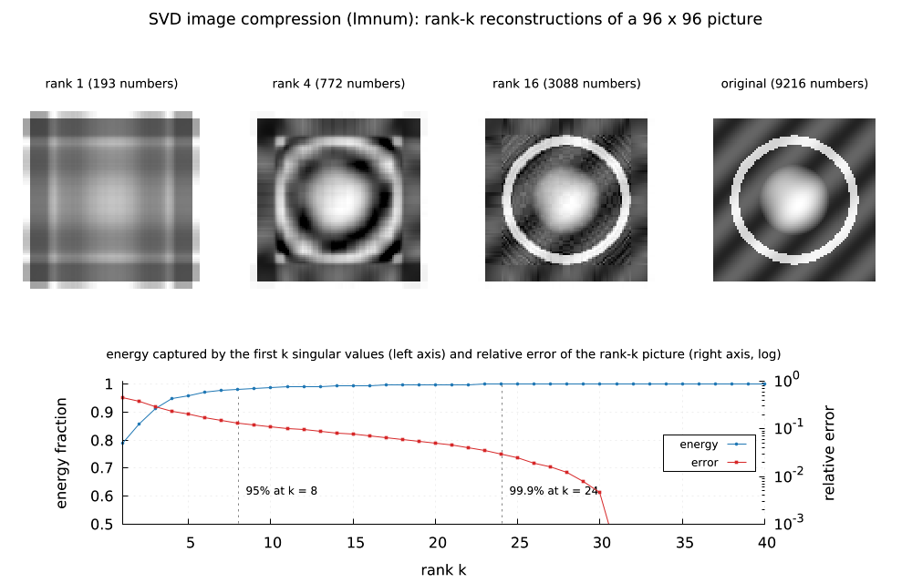 |
| --- | --- |
| Least squares with 95% confidence and prediction bands; the true line sits inside three standard errors.<br>`lmctl autorun https://raw.githubusercontent.com/lmctl-ai/lmnum/main/examples/gallery/linear_regression.lms` | SVD image compression: rank 1, 4, 16 against the original, energy captured.<br>`lmctl autorun https://raw.githubusercontent.com/lmctl-ai/lmnum/main/examples/gallery/svd_compression.lms` |

| 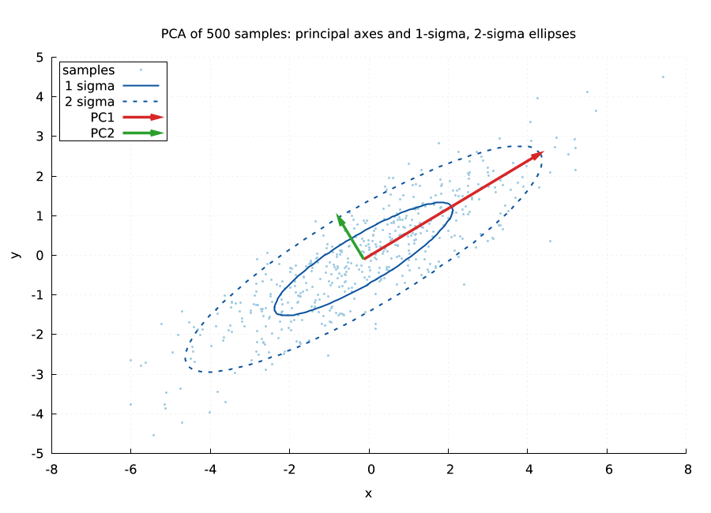 | 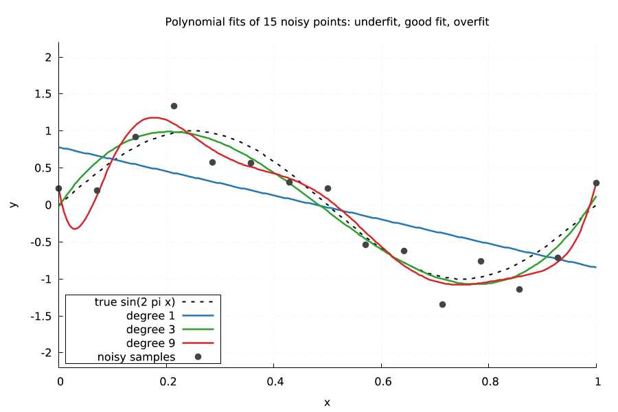 |
| --- | --- |
| PCA of 500 samples: principal axes and sigma ellipses.<br>`lmctl autorun https://raw.githubusercontent.com/lmctl-ai/lmnum/main/examples/gallery/pca_ellipse.lms` | Polynomial fits of noisy points: underfit, good fit, overfit.<br>`lmctl autorun https://raw.githubusercontent.com/lmctl-ai/lmnum/main/examples/gallery/polyfit_overfit.lms` |

| 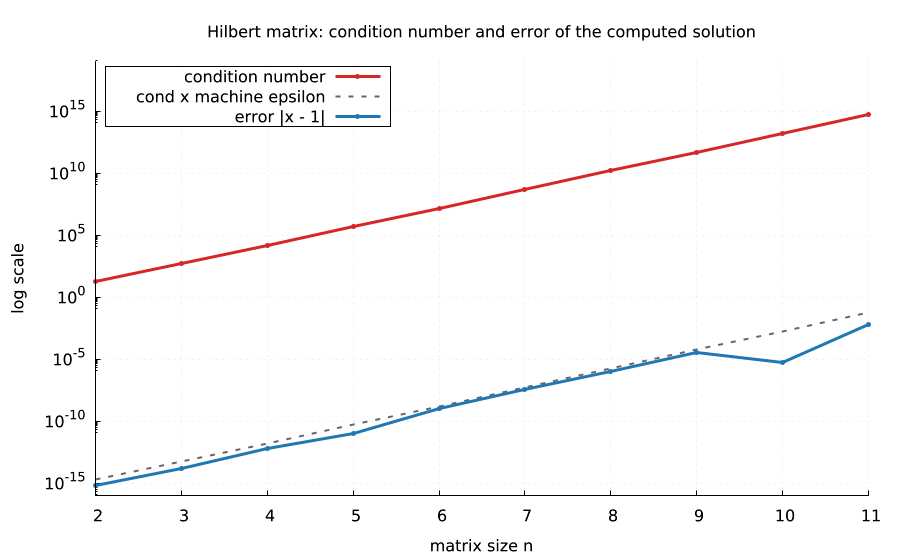 | 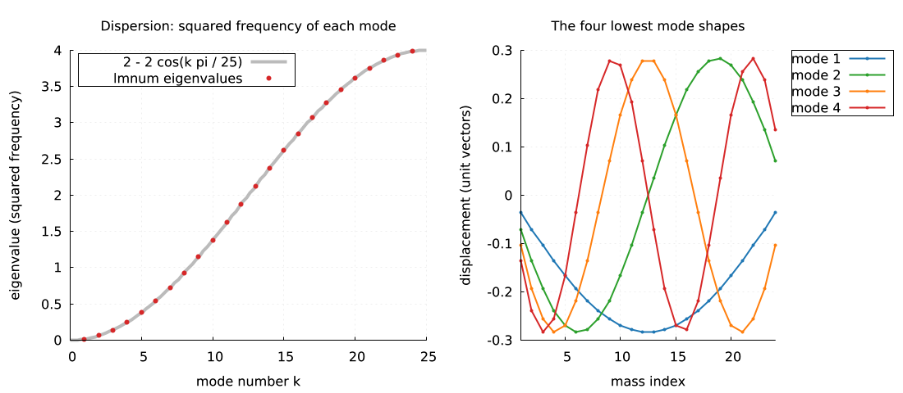 |
| --- | --- |
| Ill-conditioning: Hilbert matrices, condition number and solution error.<br>`lmctl autorun https://raw.githubusercontent.com/lmctl-ai/lmnum/main/examples/gallery/hilbert_conditioning.lms` | Normal modes of a chain of masses: eigenvalues and mode shapes.<br>`lmctl autorun https://raw.githubusercontent.com/lmctl-ai/lmnum/main/examples/gallery/vibration_modes.lms` |

| 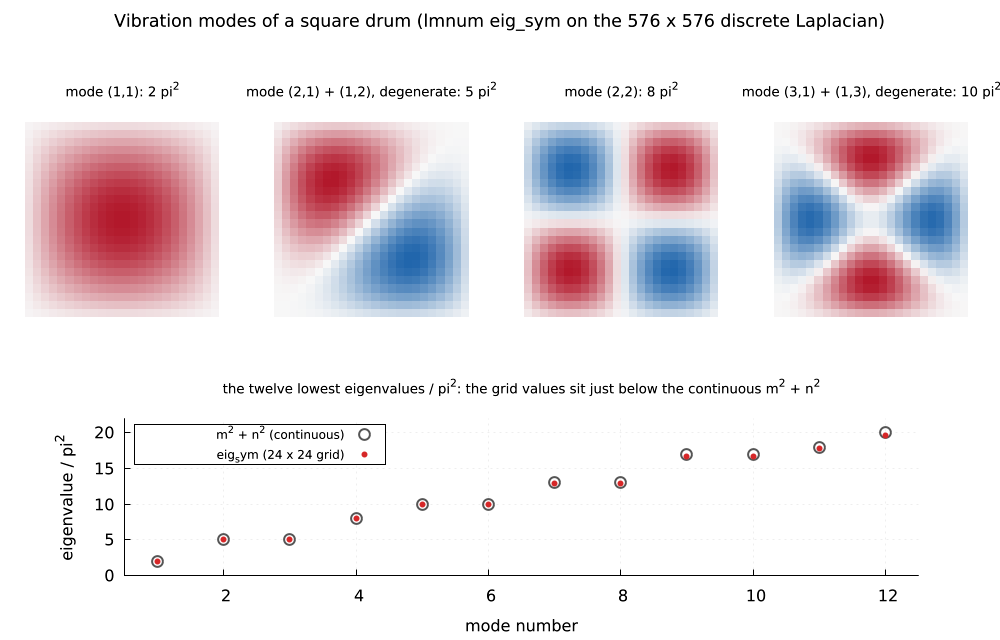 | 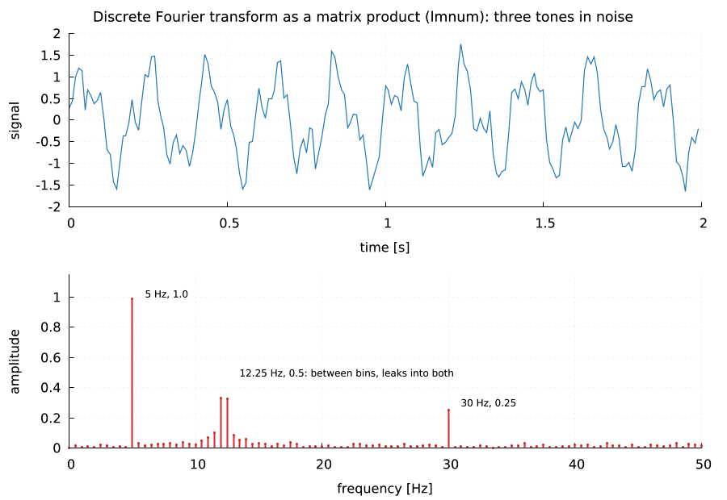 |
| --- | --- |
| Eigenmodes of a square drum from the 576 x 576 discrete Laplacian, against (m^2 + n^2) pi^2.<br>`lmctl autorun https://raw.githubusercontent.com/lmctl-ai/lmnum/main/examples/gallery/membrane_modes.lms` | A power spectrum without an FFT: the DFT as two matrix products, three tones found, one leaking between bins.<br>`lmctl autorun https://raw.githubusercontent.com/lmctl-ai/lmnum/main/examples/gallery/spectrum_dft.lms` |

| 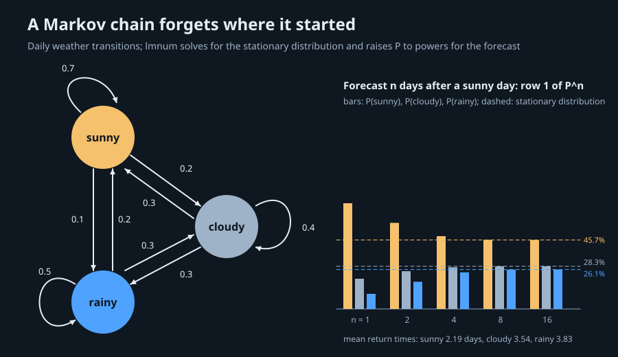 | |
| --- | --- |
| A Markov chain forgets where it started: stationary distribution by one linear solve, P^n converging (lmdraw).<br>`lmctl autorun https://raw.githubusercontent.com/lmctl-ai/lmnum/main/examples/gallery/markov_chain.lms` | |

### Integration and optimisation

| 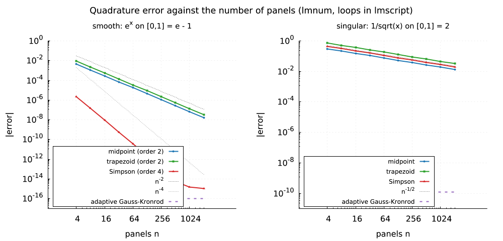 | 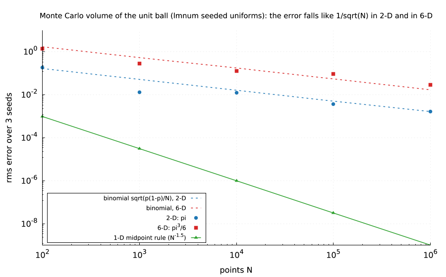 |
| --- | --- |
| Midpoint, trapezoid and Simpson errors fall as n^-2, n^-2, n^-4; a singular integrand drops every rule to n^-1/2.<br>`lmctl autorun https://raw.githubusercontent.com/lmctl-ai/lmnum/main/examples/gallery/quadrature_orders.lms` | Monte Carlo volume of the unit ball: the error falls like 1/sqrt(N) in 2-D and 6-D alike, on the binomial line.<br>`lmctl autorun https://raw.githubusercontent.com/lmctl-ai/lmnum/main/examples/gallery/monte_carlo.lms` |

| 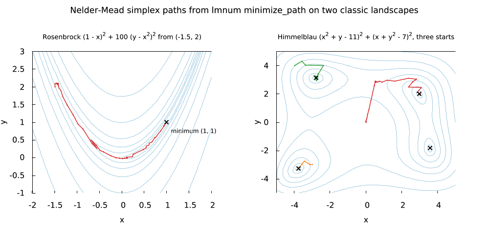 | |
| --- | --- |
| Nelder-Mead simplex paths down the Rosenbrock valley and into three of Himmelblau's four minima.<br>`lmctl autorun https://raw.githubusercontent.com/lmctl-ai/lmnum/main/examples/gallery/nelder_mead.lms` | |

Each command runs the example from any empty directory: lmnum computes, [lmplot](https://github.com/lmctl-ai/lmplot) or [lmdraw](https://github.com/lmctl-ai/lmdraw) draws, and the picture lands in `images/`. `examples/render-all.sh` regenerates `docs/images/` from a checkout.

**Quick start:** `npm i -g @lmctl-ai/lmctl`, then paste any `lmctl autorun` line above.

Eigen linear algebra, SUNDIALS ODE and nonlinear solvers, integration, root finding, optimization and
fitting, with no Python and no BLAS. It is a scripting
host, not a command-line tool: write an [lmscript](https://lmctl.com/tools/lmscript/skill.html)
`_dsl_` block, compile it, run it with `lmnum --dsl`. One static executable, no shared libraries.

```
# lotka-volterra.lms
p = _dsl_ cli="lmnum" install="github:lmctl-ai/lmnum@latest";
let sys = num.ode(2);
sys.param("a", 1.1).param("b", 0.4).param("c", 0.4).param("d", 0.1);
sys.rhs(0, "a*y0 - b*y0*y1").rhs(1, "d*y0*y1 - c*y1");
sys.init(0, 10.0).init(1, 10.0);
let sol = sys.solve(0.0, 60.0, 601);          # rows: t, prey, predators
sol.save_csv("lv.csv");
end _dsl_
savedsl(p, "lv.dslb");
system ${dsl_cli(p)} --dsl lv.dslb;
```

`lmscript lotka-volterra.lms` finds `lmnum` on `PATH` or downloads the release binary for your
platform on first use, compiles against the schema built into it, and runs the program.

## What it does

Functions are passed as expression strings (`"sin(x)*exp(-k*t)"`, variables and parameters named
in the call) because the DSL has no closures. The expression language is described in
[durable-memory/04-expressions.md](durable-memory/04-expressions.md).

| `num.` | |
| --- | --- |
| `matrix` `identity` `parse` `linspace` `random` `normal` `load_csv` | build matrices (deterministic seeds) |
| `ode(n)` → `.rhs .init .param .tol .stiff .solve` | CVODE: Adams or BDF (stiff), dense Newton; returns `t, y0..yn` |
| `system(n)` → `.eq .solve` | KINSOL: nonlinear systems F(x) = 0 |
| `integrate` `integrate_tol` `root` `minimize` `minimize_path` | adaptive Gauss-Kronrod, Brent, Nelder-Mead (and its iterations) |
| `polyfit` `polyval` `interp` | least-squares polynomials, linear interpolation |
| `func(expr, vars)` → `.eval .eval2`, `Matrix.map` | evaluate expressions |
| `eval(expr)` `assert_close` `print` `version` | constants, checks, output |

`Matrix` methods: `rows cols get set copy add sub mul hadamard scale shift transpose inverse det
trace norm solve lstsq eig_sym eigvec_sym svd_values svd_u svd_v cholesky col row block hstack vstack sorted sum mean min
max std map to_text save_csv`. Schema and rules: [durable-memory/03-schema-v0.md](durable-memory/03-schema-v0.md).

Combine it with other hosts in one script: [examples/gallery/lorenz_attractor.lms](examples/gallery/lorenz_attractor.lms)
integrates the Lorenz system with lmnum and draws it with [lmplot](https://github.com/lmctl-ai/lmplot)
(two `_dsl_` blocks, two hosts).

## Examples

| Program | Shows | Run it |
| --- | --- | --- |
| [linear_algebra.lms](examples/linear_algebra.lms) | solve, inverse, determinant, eigenvalues, SVD, least squares, each asserted | `lmctl autorun https://raw.githubusercontent.com/lmctl-ai/lmnum/main/examples/linear_algebra.lms` |
| [ode_lotka_volterra.lms](examples/ode_lotka_volterra.lms) | predator-prey, conserved quantity checked along 601 points | `lmctl autorun https://raw.githubusercontent.com/lmctl-ai/lmnum/main/examples/ode_lotka_volterra.lms` |
| [ode_stiff.lms](examples/ode_stiff.lms) | Robertson kinetics with BDF | `lmctl autorun https://raw.githubusercontent.com/lmctl-ai/lmnum/main/examples/ode_stiff.lms` |
| [calculus.lms](examples/calculus.lms) | integration, roots, Rosenbrock minimum, nonlinear system, fits | `lmctl autorun https://raw.githubusercontent.com/lmctl-ai/lmnum/main/examples/calculus.lms` |
| [gallery/predator_prey.lms](examples/gallery/predator_prey.lms) | five Lotka-Volterra orbits, conserved quantity H asserted | `lmctl autorun https://raw.githubusercontent.com/lmctl-ai/lmnum/main/examples/gallery/predator_prey.lms` |
| [gallery/van_der_pol.lms](examples/gallery/van_der_pol.lms) | limit cycle amplitude 2.0 from six starting points | `lmctl autorun https://raw.githubusercontent.com/lmctl-ai/lmnum/main/examples/gallery/van_der_pol.lms` |
| [gallery/stiff_kinetics.lms](examples/gallery/stiff_kinetics.lms) | Robertson kinetics restarted decade by decade, mass conserved | `lmctl autorun https://raw.githubusercontent.com/lmctl-ai/lmnum/main/examples/gallery/stiff_kinetics.lms` |
| [gallery/heat_diffusion.lms](examples/gallery/heat_diffusion.lms) | 59-point stiff ODE system checked against the exact two-mode solution | `lmctl autorun https://raw.githubusercontent.com/lmctl-ai/lmnum/main/examples/gallery/heat_diffusion.lms` |
| [gallery/newton_fractal.lms](examples/gallery/newton_fractal.lms) | 160 000 Newton iterations written in lmscript loops | `lmctl autorun https://raw.githubusercontent.com/lmctl-ai/lmnum/main/examples/gallery/newton_fractal.lms` |
| [gallery/polyfit_overfit.lms](examples/gallery/polyfit_overfit.lms) | seeded noise, `polyfit` of degree 1, 3, 9 | `lmctl autorun https://raw.githubusercontent.com/lmctl-ai/lmnum/main/examples/gallery/polyfit_overfit.lms` |
| [gallery/pca_ellipse.lms](examples/gallery/pca_ellipse.lms) | covariance eigenvalues checked against the population values | `lmctl autorun https://raw.githubusercontent.com/lmctl-ai/lmnum/main/examples/gallery/pca_ellipse.lms` |
| [gallery/sir_epidemic.lms](examples/gallery/sir_epidemic.lms) | SIR epidemic: final size from CVODE against the Brent root of s = S0 exp(-R0 (1 - s)) | `lmctl autorun https://raw.githubusercontent.com/lmctl-ai/lmnum/main/examples/gallery/sir_epidemic.lms` |
| [gallery/logistic_bifurcation.lms](examples/gallery/logistic_bifurcation.lms) | bifurcation diagram and Lyapunov exponent; period-2 points and exponent asserted | `lmctl autorun https://raw.githubusercontent.com/lmctl-ai/lmnum/main/examples/gallery/logistic_bifurcation.lms` |
| [gallery/hilbert_conditioning.lms](examples/gallery/hilbert_conditioning.lms) | condition number from `svd_values` against the error of `solve` | `lmctl autorun https://raw.githubusercontent.com/lmctl-ai/lmnum/main/examples/gallery/hilbert_conditioning.lms` |
| [gallery/vibration_modes.lms](examples/gallery/vibration_modes.lms) | 24-mass chain: `eig_sym` against 2 - 2 cos(k pi / 25) | `lmctl autorun https://raw.githubusercontent.com/lmctl-ai/lmnum/main/examples/gallery/vibration_modes.lms` |
| [gallery/lorenz_anim.lms](examples/gallery/lorenz_anim.lms) | 90 frames drawn by lmplot, encoded with ffmpeg | `lmctl autorun https://raw.githubusercontent.com/lmctl-ai/lmnum/main/examples/gallery/lorenz_anim.lms` |
| [gallery/linear_regression.lms](examples/gallery/linear_regression.lms) | `lstsq` on [1 x]; standard errors, 95% confidence and prediction bands, coverage ~95% asserted, `polyfit` agrees to 1e-9 | `lmctl autorun https://raw.githubusercontent.com/lmctl-ai/lmnum/main/examples/gallery/linear_regression.lms` |
| [gallery/pendulum.lms](examples/gallery/pendulum.lms) | period from the zero crossing against (2/pi) K(sin(theta0/2)) by `integrate`, 1.18034 at 90 degrees | `lmctl autorun https://raw.githubusercontent.com/lmctl-ai/lmnum/main/examples/gallery/pendulum.lms` |
| [gallery/orbital.lms](examples/gallery/orbital.lms) | x'' = -x/r^3: return to apoapsis after exactly 2 pi, energy and L drift < 1e-8 over ten orbits, T = 2 pi a^1.5 measured | `lmctl autorun https://raw.githubusercontent.com/lmctl-ai/lmnum/main/examples/gallery/orbital.lms` |
| [gallery/wave_equation.lms](examples/gallery/wave_equation.lms) | 398 first-order equations; d'Alembert solution before the first reflection to 2e-3, energy constant to 1e-3 | `lmctl autorun https://raw.githubusercontent.com/lmctl-ai/lmnum/main/examples/gallery/wave_equation.lms` |
| [gallery/burgers.lms](examples/gallery/burgers.lms) | 399 points, BDF; characteristics solved with `root` at t = 0.1, slope at the origin -152 (Basdevant) to 5% | `lmctl autorun https://raw.githubusercontent.com/lmctl-ai/lmnum/main/examples/gallery/burgers.lms` |
| [gallery/quadrature_orders.lms](examples/gallery/quadrature_orders.lms) | orders 2, 2, 4 from log2 error ratios, 0.5 on 1/sqrt(x); Gauss-Kronrod `integrate` reaches 1e-7 on the singular one | `lmctl autorun https://raw.githubusercontent.com/lmctl-ai/lmnum/main/examples/gallery/quadrature_orders.lms` |
| [gallery/monte_carlo.lms](examples/gallery/monte_carlo.lms) | `random` in 2-D and 6-D, rms error over seeds against sqrt(p(1-p)/N), fitted slope -0.5 | `lmctl autorun https://raw.githubusercontent.com/lmctl-ai/lmnum/main/examples/gallery/monte_carlo.lms` |
| [gallery/nelder_mead.lms](examples/gallery/nelder_mead.lms) | `minimize_path`: Rosenbrock from (-1.5, 2) to (1, 1) in 1e-4; Himmelblau from three starts to three minima | `lmctl autorun https://raw.githubusercontent.com/lmctl-ai/lmnum/main/examples/gallery/nelder_mead.lms` |
| [gallery/svd_compression.lms](examples/gallery/svd_compression.lms) | `svd_u`, `svd_values`, `svd_v`: full rank rebuilds exactly, Eckart-Young error = dropped energy | `lmctl autorun https://raw.githubusercontent.com/lmctl-ai/lmnum/main/examples/gallery/svd_compression.lms` |
| [gallery/membrane_modes.lms](examples/gallery/membrane_modes.lms) | `eig_sym` on the 2-D Laplacian: eigenvalues to 1e-9 against the discrete formula, 1% against (m^2 + n^2) pi^2 | `lmctl autorun https://raw.githubusercontent.com/lmctl-ai/lmnum/main/examples/gallery/membrane_modes.lms` |
| [gallery/spectrum_dft.lms](examples/gallery/spectrum_dft.lms) | cos/sin matrices times the signal: peaks at 5 and 30 Hz exact, Parseval to 1e-9, leakage of the off-bin tone | `lmctl autorun https://raw.githubusercontent.com/lmctl-ai/lmnum/main/examples/gallery/spectrum_dft.lms` |
| [gallery/markov_chain.lms](examples/gallery/markov_chain.lms) | stationary distribution 21/46, 13/46, 12/46 by `solve`; P^16 rows within 1e-5; eigenvalues 0.3 +- sqrt(0.03) by `det` | `lmctl autorun https://raw.githubusercontent.com/lmctl-ai/lmnum/main/examples/gallery/markov_chain.lms` |

## Build

C++17 compiler, CMake 3.24, git; nothing else.

```sh
scripts/sync-deps.sh            # Eigen and SUNDIALS at the commits in deps.lock
cmake -S . -B build && cmake --build build
./test.sh                       # needs lmscript on PATH
```

Linux builds are fully static; macOS links only system libraries; Windows links the MinGW runtime
statically. `lmnum --notices` prints the license texts of everything inside.

## Resource limits

A program may use at most 4096 MiB in total (matrices, solver state, everything the host keeps);
beyond that it stops with a run error (exit 3) naming the limit, instead of exhausting the machine.
Set `LMNUM_MAX_MEMORY_MB` to change it, e.g. `LMNUM_MAX_MEMORY_MB=16384 lmscript big.lms`.

## License

MIT ([LICENSE](LICENSE)). SUNDIALS is BSD-3-Clause; Eigen is MPL-2.0 (used with `EIGEN_MPL2_ONLY`,
unmodified); see [THIRD_PARTY_NOTICES](THIRD_PARTY_NOTICES).
