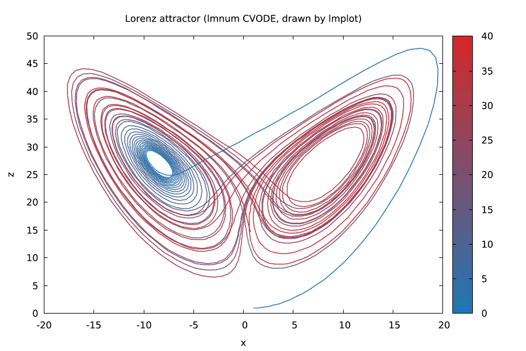

# lmnum

**Numerical computing for lmscript in one static executable: Eigen linear algebra, SUNDIALS ODE
and nonlinear solvers, integration, root finding, optimization and fitting.** It is a scripting
host, not a command-line tool: write an [lmscript](https://lmctl.com/tools/lmscript/skill.html)
`_dsl_` block, compile it, run it with `lmnum --dsl`. No Python, no BLAS, no shared libraries.

[](https://github.com/lmctl-ai/lmnum/actions/workflows/ci.yml)
[](LICENSE)

```
# lotka-volterra.lms
p = _dsl_ cli="lmnum" install="github:lmctl-ai/lmnum@latest";
let sys = num.ode(2);
sys.param("a", 1.1).param("b", 0.4).param("c", 0.4).param("d", 0.1);
sys.rhs(0, "a*y0 - b*y0*y1").rhs(1, "d*y0*y1 - c*y1");
sys.init(0, 10.0).init(1, 10.0);
let sol = sys.solve(0.0, 60.0, 601);          # rows: t, prey, predators
sol.save_csv("lv.csv");
end _dsl_
savedsl(p, "lv.dslb");
system ${dsl_cli(p)} --dsl lv.dslb;
```

`lmscript lotka-volterra.lms` finds `lmnum` on `PATH` or downloads the release binary for your
platform on first use, compiles against the schema built into it, and runs the program.

## What it does

Functions are passed as expression strings (`"sin(x)*exp(-k*t)"`, variables and parameters named
in the call) because the DSL has no closures. The expression language is described in
[durable-memory/04-expressions.md](durable-memory/04-expressions.md).

| `num.` | |
| --- | --- |
| `matrix` `identity` `parse` `linspace` `random` `normal` `load_csv` | build matrices (deterministic seeds) |
| `ode(n)` → `.rhs .init .param .tol .stiff .solve` | CVODE: Adams or BDF (stiff), dense Newton; returns `t, y0..yn` |
| `system(n)` → `.eq .solve` | KINSOL: nonlinear systems F(x) = 0 |
| `integrate` `root` `minimize` | adaptive Gauss-Kronrod, Brent, Nelder-Mead |
| `polyfit` `polyval` `interp` | least-squares polynomials, linear interpolation |
| `func(expr, vars)` → `.eval .eval2`, `Matrix.map` | evaluate expressions |
| `eval(expr)` `assert_close` `print` `version` | constants, checks, output |

`Matrix` methods: `rows cols get set copy add sub mul hadamard scale shift transpose inverse det
trace norm solve lstsq eig_sym eigvec_sym svd_values col row hstack vstack sum mean min max std map
to_text save_csv`. Schema and rules: [durable-memory/03-schema-v0.md](durable-memory/03-schema-v0.md).

Combine it with other hosts in one script: [examples/combo/lorenz_plot.lms](examples/combo/lorenz_plot.lms)
integrates the Lorenz system with lmnum and draws it with [lmplot](https://github.com/lmctl-ai/lmplot)
(two `_dsl_` blocks, two hosts).



## Examples

| Program | Shows |
| --- | --- |
| [linear_algebra.lms](examples/linear_algebra.lms) | solve, inverse, determinant, eigenvalues, SVD, least squares, each asserted |
| [ode_lotka_volterra.lms](examples/ode_lotka_volterra.lms) | predator-prey, conserved quantity checked along 601 points |
| [ode_stiff.lms](examples/ode_stiff.lms) | Robertson kinetics with BDF |
| [calculus.lms](examples/calculus.lms) | integration, roots, Rosenbrock minimum, nonlinear system, fits |
| [combo/lorenz_plot.lms](examples/combo/lorenz_plot.lms) | lmnum computes, lmplot draws |

## Build

C++17 compiler, CMake 3.24, git; nothing else.

```sh
scripts/sync-deps.sh            # Eigen and SUNDIALS at the commits in deps.lock
cmake -S . -B build && cmake --build build
./test.sh                       # needs lmscript on PATH
```

Linux builds are fully static; macOS links only system libraries; Windows links the MinGW runtime
statically. `lmnum --notices` prints the license texts of everything inside.

## License

MIT ([LICENSE](LICENSE)). SUNDIALS is BSD-3-Clause; Eigen is MPL-2.0 (used with `EIGEN_MPL2_ONLY`,
unmodified); see [THIRD_PARTY_NOTICES](THIRD_PARTY_NOTICES).
